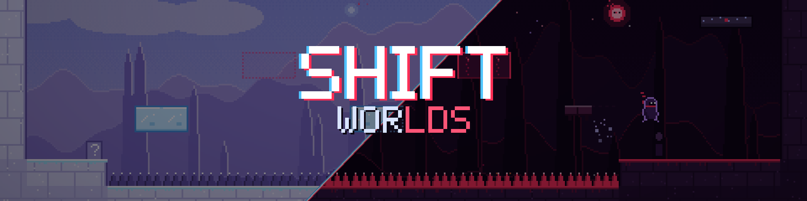
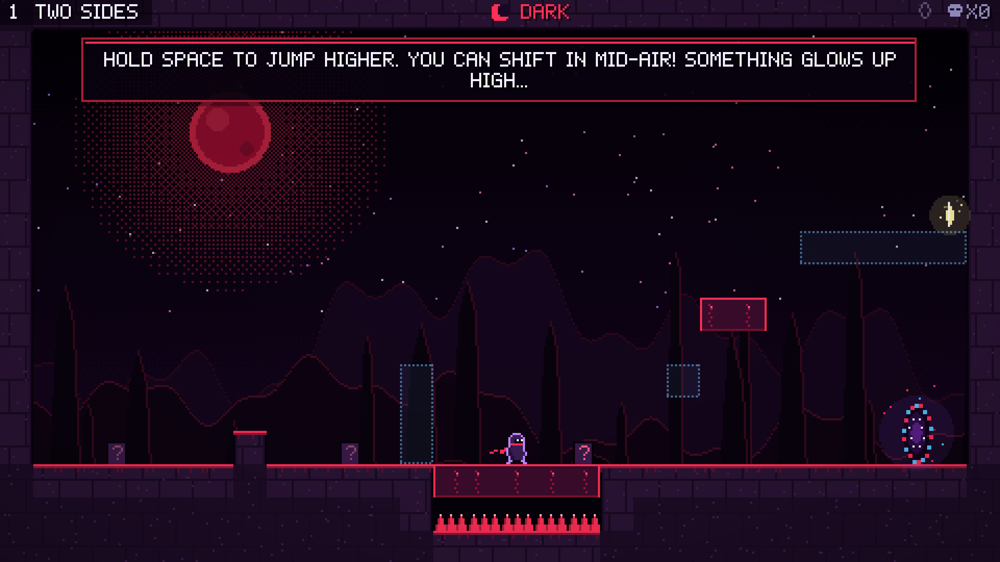
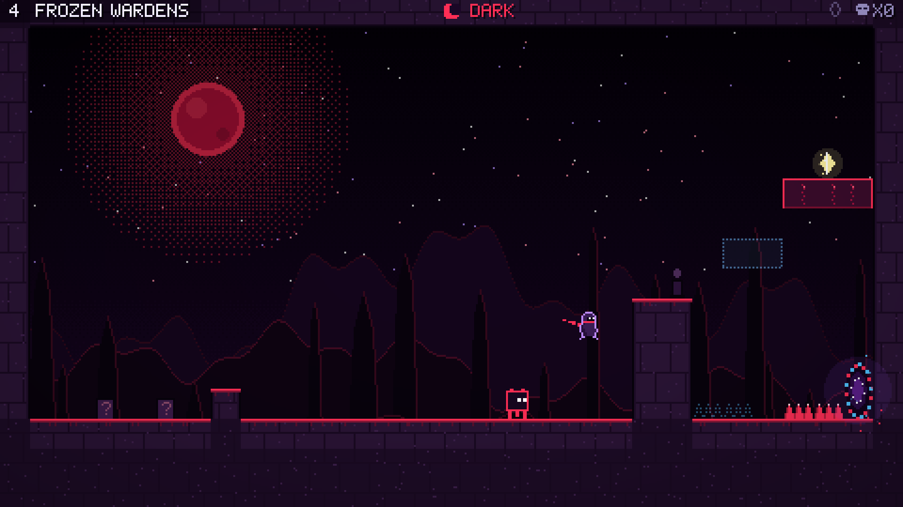
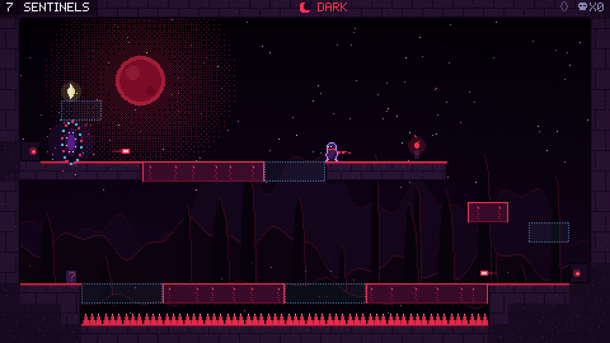
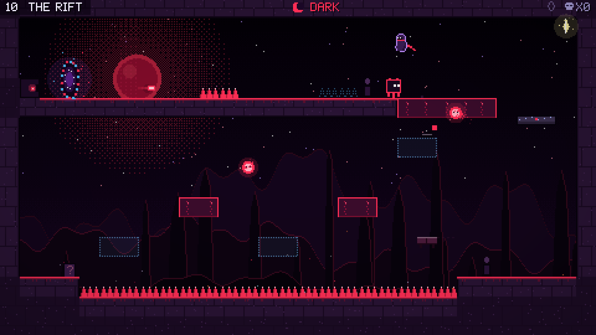

<div align="center">



# SHIFT WORLDS

### *One world isn't enough. Live in both.*

A 2D pixel-art puzzle-platformer about jumping between two parallel dimensions.<br>
Made for **GitHub Game Off 2026**, theme **SHIFT**.

[](CHANGELOG.md)
[](https://godotengine.org)
[](#-download--play)
[](LICENSE)
[](CREDITS.md)

**[⬇ Download](https://github.com/vhm4d777/shift-world/releases)** ·
**[🎮 Controls](#-controls)** ·
**[✨ Features](#-features)** ·
**[🛠 Build from source](#-building-from-source)**

</div>

---

## 🌗 The game

You fell into the seam between two parallel dimensions.

Press **SHIFT** to flip between the bright **Light World** and the neon **Dark World**. Platforms,
hazards, machines and monsters all change when you cross over. A wall in one world is empty air
in the other, and a deadly hunter in one becomes a harmless drifter in the other.

Time your shifts right, even in mid-air, and find your way to the exit rift.

<div align="center">
<table>
  <tr>
    <td></td>
    <td></td>
  </tr>
  <tr>
    <td></td>
    <td></td>
  </tr>
</table>
</div>

---

## ✨ Features

- **🔀 One mechanic, explored in depth.** Shift between worlds instantly, even in mid-air.
- **🧩 110 levels in 11 worlds.** 10 handcrafted levels teach each idea, then 100 more get harder level by level.
- **👹 11 boss fights**, one after every 10 levels: health bars, screen shake, an enraged second phase and attacks you dodge by shifting worlds.
- **🪙 Tokens and a shop.** Collect coins in every level and spend them on 8 skins and 7 weapons for the boss fights.
- **✏️ Your own name** (Latin or Cyrillic) shown in game, on the results screen and in the credits.
- **💎 A hidden Memory Shard in each of the first 10 levels** for players who want to find everything.
- **🎵 Adaptive music.** Three soundtracks (two level themes and a boss theme), each with Light and Dark layers that crossfade every time you shift.
- **🎨 Original pixel art and a custom pixel font**, a different backdrop for every world, bloom, soft shadows, particles, screen shake and a shockwave/chromatic shift effect.
- **⏱ Auto-save, best times, a death counter** and an optional speedrun timer.
- **🎮 Keyboard, mouse and gamepad** support.

### Things that behave differently in each world

| | ☀️ Light World | 🌙 Dark World |
|---|---|---|
| **Wardens** | Frozen into solid crystal you can stand on | Patrol the level |
| **Wisps** | Drift home harmlessly | Hunt you down |
| **Sentinels** | Their bolts dissolve | Fire bolts at you |
| **Machines** | Moving platforms and lifts run | Time stands still |
| **Blocks & spikes** | Light-only pieces appear | Dark-only pieces appear |

Levers and gates, crumbling bridges and checkpoints round out the toolbox.

---

## ⬇ Download & play

Get the latest build from the **[Releases](https://github.com/vhm4d777/shift-world/releases)** page.

<details open>
<summary><b>🪟 Windows 10/11 (64-bit)</b></summary>

1. Download `ShiftWorlds-v1.0.0-windows.zip`.
2. Right-click it and choose **Extract All...**
3. Double-click **`ShiftWorlds.exe`**.

There's no installer: the game is portable and runs from any folder, including a USB stick.
The game isn't code-signed, so SmartScreen may say *"Windows protected your PC"* the first time.
Click **More info → Run anyway**.
</details>

<details>
<summary><b>🐧 Linux (64-bit)</b></summary>

```bash
unzip ShiftWorlds-v1.0.0-linux.zip
chmod +x ShiftWorlds.x86_64
./ShiftWorlds.x86_64
```
</details>

<details>
<summary><b>🍎 macOS (experimental, unsigned)</b></summary>

Extract `ShiftWorlds-v1.0.0-macos.zip`, then **right-click** `SHIFT WORLDS.app` and choose **Open**.
Apple can't verify the developer, so you'll need to confirm the first launch.
</details>

<details>
<summary><b>💻 System requirements</b></summary>

| | Minimum |
|---|---|
| OS | Windows 10/11 (64-bit), Ubuntu 20.04+ or similar, macOS 10.13+ |
| CPU | Any 64-bit dual-core processor |
| Graphics | OpenGL 3.3, or DirectX 11 on Windows (through ANGLE) |
| Memory | 2 GB RAM |
| Storage | 150 MB |
</details>

<details>
<summary><b>💾 Where saves are stored</b></summary>

Progress and settings save automatically to:

- **Windows:** `%APPDATA%\ShiftWorlds\save.json`
- **Linux:** `~/.local/share/ShiftWorlds/save.json`
- **macOS:** `~/Library/Application Support/ShiftWorlds/save.json`
</details>

---

## 🎮 Controls

| Action | Keyboard | Gamepad |
|---|---|---|
| Move | <kbd>A</kbd> <kbd>D</kbd> / <kbd>←</kbd> <kbd>→</kbd> | Left stick / D-pad |
| Jump *(hold for higher)* | <kbd>Space</kbd> (also <kbd>W</kbd>, <kbd>↑</kbd>, <kbd>Z</kbd>) | A / Cross |
| **Shift worlds** | <kbd>Shift</kbd> (also <kbd>X</kbd>, <kbd>K</kbd>) | X / Square, bumpers |
| **Shoot** *(boss fights)* | <kbd>J</kbd> / <kbd>F</kbd> / <kbd>C</kbd> / <kbd>Ctrl</kbd> / left click | B / Circle, right trigger |
| Restart level | <kbd>R</kbd> | Y / Triangle |
| Pause | <kbd>Esc</kbd> / <kbd>P</kbd> | Start |
| Fullscreen | <kbd>F11</kbd> | — |

Menus also work with the mouse.

> [!TIP]
> You can't shift if the other world has something solid where you're standing. Look before you leap... between worlds.

---

## 🛠 Building from source

**Requirements:** [Godot 4.5.1](https://godotengine.org/download) (standard build) and its export templates.

```bash
git clone https://github.com/vhm4d777/shift-world.git
cd shift-world
godot project.godot          # opens the editor; press F5 to play
```

<details>
<summary><b>📦 Exporting builds</b></summary>

With the export templates installed (*Editor → Manage Export Templates*):

```bash
godot --headless --export-release "Windows Desktop" build/windows/ShiftWorlds.exe
godot --headless --export-release "Linux"           build/linux/ShiftWorlds.x86_64
godot --headless --export-release "macOS"           build/macos/ShiftWorlds.zip
```

The Windows and Linux presets embed the game data in the executable, so each build is a single portable file.
The Windows icon and version info are applied automatically from `assets/icon.ico`.
</details>

<details>
<summary><b>🧪 Automated tests</b></summary>

```bash
# Prove every level's exit AND memory shard are reachable (search over the real game physics)
godot --headless -s res://tests/solve.gd            # or: -- 7   for a single level

# Play all 110 levels end-to-end through the real game scene, collecting every token
# (SHIFTWORLDS_SAVE keeps the tests away from your real save file)
SHIFTWORLDS_SAVE=test_save.json godot --headless -s res://tests/playthrough.gd

# Fight all 11 bosses with a bot (checks every boss can be beaten)
godot --headless -s res://tests/boss_test.gd

# Render screenshots of every screen and level (needs a display, e.g. xvfb-run)
godot --rendering-driver opengl3 -s res://tests/screenshots.gd -- /tmp/shots
```
</details>

<details>
<summary><b>🎨 Regenerating assets</b></summary>

All art and audio are generated by scripts. You don't need to run them, but you can:

```bash
python3 tools/generate_art.py                       # backgrounds + icon      (needs Pillow)
python3 tools/generate_audio.py                     # sound effects + music   (needs numpy)
python3 tools/generate_audio_v2.py                  # 2.0 boss/shop sounds, boss + second theme
godot --headless -s res://tools/bake_backdrops.gd   # world backdrops -> assets/themes
godot --headless -s res://tools/gen_levels.gd -- gen 11 110   # generate + verify levels 11-110
godot --headless -s res://tools/gen_levels.gd -- assemble     # write scripts/levels_gen.gd
python3 tools/make_store_assets.py /tmp/marketing   # itch.io cover/banner/screenshots
```
</details>

<details>
<summary><b>🗂 Project structure</b></summary>

```
project.godot            Godot project settings (480x272 pixel-perfect viewport)
export_presets.cfg       Windows / Linux / macOS export presets
scenes/main.tscn         Entry scene
scripts/
  sim.gd                 Deterministic game simulation (physics, worlds, enemies, triggers, tokens)
  boss.gd                Boss fights: attack patterns, phases, projectiles
  levels.gd              Handcrafted levels, boss arenas and the world/stage layout
  levels_gen.gd          Generated levels 11-110 (written by tools/gen_levels.gd)
  backdrops.gd           Procedural world backdrops (baked to assets/themes)
  level_view.gd          Rendering, animation, particles and shift effects
  main.gd                Game flow, menus, HUD, transitions
  game.gd   (autoload)   Save file, settings, progress, input bindings
  sound.gd  (autoload)   Sound effects and the synchronised music layers
  pixel_font.gd          Original 5x7 pixel font
shaders/post.gdshader    Shockwave, chromatic aberration, bloom, grain, flash and vignette
assets/                  Generated backgrounds and icon
audio/                   Generated sound effects and music
tests/                   Level solver, end-to-end playthrough, screenshot tools
tools/                   Asset generators and license dump
itch/                    Store page text, cover, banner and screenshots
```
</details>

### 🧱 Make your own levels

Levels are 30×17 ASCII grids in [`scripts/levels.gd`](scripts/levels.gd):

| Symbol | Meaning | Symbol | Meaning |
|:---:|---|:---:|---|
| `L` | Light-only block | `w` | Warden |
| `D` | Dark-only block | `f` | Wisp |
| `S` | Lever | `G` | Gate |

The full legend is at the top of the file. After editing, run `tests/solve.gd` to check that the level can be beaten.

---

## 📜 Credits & licenses

- **Design, code, pixel art, music & sound:** Shift Worlds Team. See [CREDITS.md](CREDITS.md).
- **Source code:** [MIT License](LICENSE).
- **Art & audio** (`assets/`, `audio/`): **CC0 1.0**, made from scratch by the scripts in `tools/`.
- **Engine:** [Godot Engine](https://godotengine.org) (MIT). Third-party notices are in [THIRD_PARTY_LICENSES.txt](THIRD_PARTY_LICENSES.txt).

No third-party or copyrighted assets are used.

<div align="center">
<br>
<b>Made with 💜 for GitHub Game Off 2026</b>
</div>
